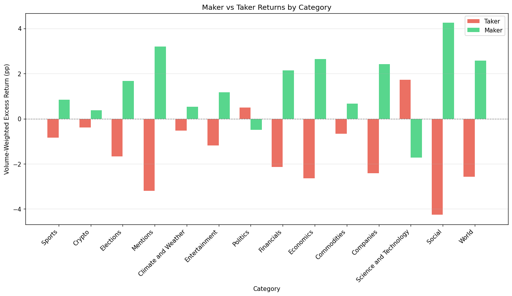

# Prediction Market Analysis

A framework for analyzing prediction market data, including the largest publicly available dataset of Polymarket and Kalshi market and trade data. Provides tools for data collection, storage, and running analysis scripts that generate figures and statistics.

> **About this fork.** This is a fork of [Jon-Becker/prediction-market-analysis](https://github.com/Jon-Becker/prediction-market-analysis). The original framework, Polymarket support and the original analyses are Jon Becker's work. The Kalshi changes and new analyses described below are mine.

> [!WARNING]
**Recent testing has shown that Kalshi's API is limiting unauth'd requests at undocumented rates that differ for each endpoint. A future update should implement Kalshi account auth to improve preformance. In the meantime, the KalshiClient in each indexer should be configured with a rate limit discovered through use.**

## What's New in This Fork

### Kalshi data collection

- **Updated for Kalshi API changes.** Uses the current API host and Kalshi's separate `/historical/markets` and `/historical/trades` endpoints, which serve historical data.
- **Recent and historical datasets.** Data is stored as `data/kalshi/{markets,trades}` and `data/kalshi/historical/{markets,trades}`, mirroring how the API serves it, so each set can be refreshed on its own.
- **API-supplied event categories.** Replaces the original regex-based categorization of event tickers with the `category` Kalshi returns for each event (Sports, Crypto, Politics, ...). A new indexer for pulling events from the API based on event tickers drawn from indexed markets is added. Events are stored once in `data/kalshi/events` and shared by both datasets.
- **Memory fix for the trades indexer.** The original indexer kept a reference to every completed future, so each market's full trade list stayed in memory for the whole run, and it ran out of RAM on the full dataset. Completed futures are now released as soon as their trades are buffered, all worker threads share one rate-limited HTTP client instead of creating one per market, and deduplication loads only the saved market tickers instead of every trade ID.
- **Incremental updates.** Indexers can fetch only markets newer than what's already saved, or only finalized markets that are missing trades.

### New analyses

**Certain analyses now allow date input to specify range over which to do analysis**

| Analysis | What it shows |
| --- | --- |
| `maker_taker_returns_by_event_category` | Maker vs taker excess returns for each event category |
| `maker_returns_by_direction_and_event_category` | Maker returns on YES vs NO positions within one category, over an optional date range |
| `taker_returns_by_direction_and_event_category` | The taker-side counterpart: YES vs NO taker returns within one category |
| `win_rate_by_price_event_category` | Calibration (win rate vs contract price) within one category |
| `returns_by_proximity_to_close` | Maker excess returns by how close to market close the trade happened |
| `market_event_categories` | Treemap of notional volume by event category |
| `longshot_volume_share_over_time_monthly` | Monthly share of taker volume in longshot contracts (1–20¢) |
| `maker_returns_over_time_3d` (+ `_historical`) | Interactive 3D chart of maker excess returns by price and week for a given category, with a rolling average per price |

Category analyses ask which category to analyze when run.



*Maker vs taker excess returns by event category, historical Kalshi data. Makers earn positive excess returns in nearly every category, and the gap is largest in thin categories like Mentions and Social.*

# Jon Becker's original Readme follows:

## Overview

This project enables research and analysis of prediction markets by providing:
- Pre-collected datasets from Polymarket and Kalshi
- Data collection indexers for gathering new data
- Analysis framework for generating figures and statistics

Currently supported features:
- Market metadata collection (Kalshi & Polymarket)
- Trade history collection via API and blockchain
- Parquet-based storage with automatic progress saving
- Extensible analysis script framework

## Installation & Usage

Requires Python 3.9+. Install dependencies with [uv](https://github.com/astral-sh/uv):

```bash
uv sync
```

Download and extract the pre-collected dataset (36GiB compressed):

```bash
make setup
```

This downloads `data.tar.zst` from [Cloudflare R2 Storage](https://s3.jbecker.dev/data.tar.zst) and extracts it to `data/`.

### Data Collection

Collect market and trade data from prediction market APIs:

```bash
make index
```

This opens an interactive menu to select which indexer to run. Data is saved to `data/kalshi/` and `data/polymarket/` directories. Progress is saved automatically, so you can interrupt and resume collection.

To build the Kalshi dataset from the API, run the indexers in this order (trades and events are looked up from the saved markets):

1. **Kalshi Event Nested Markets** and **Kalshi Historical Markets**
2. **Kalshi Events**
3. **Kalshi Trades** and **Kalshi Historical Trades**

Later, to top up: run **Kalshi Event Nested Markets** with "only markets newer than the ones already saved", then **Kalshi Events** and **Kalshi Trades Finalized**.

> The pre-collected dataset from `make setup` uses the original upstream layout and has no `events` data, so the event-category analyses need data built with the indexers above.

### Running Analyses

```bash
make analyze
```

This opens an interactive menu to select which analysis to run. You can run all analyses or select a specific one. Output files (PNG, PDF, CSV, JSON) are saved to `output/`.

### Packaging Data

To compress the data directory for storage/distribution:

```bash
make package
```

This creates a zstd-compressed tar archive (`data.tar.zst`) and removes the `data/` directory.

## Project Structure

```
├── src/
│   ├── analysis/           # Analysis scripts
│   │   ├── kalshi/         # Kalshi-specific analyses
│   │   └── polymarket/     # Polymarket-specific analyses
│   ├── indexers/           # Data collection indexers
│   │   ├── kalshi/         # Kalshi API client and indexers
│   │   └── polymarket/     # Polymarket API/blockchain indexers
│   └── common/             # Shared utilities and interfaces
├── data/                   # Data directory (extracted from data.tar.zst)
│   ├── kalshi/
│   │   ├── markets/        # Recent markets
│   │   ├── trades/         # Recent trades
│   │   ├── events/         # Events + category (shared by recent and historical)
│   │   └── historical/     # New in this fork
│   │       ├── markets/
│   │       └── trades/
│   └── polymarket/
│       ├── blocks/
│       ├── markets/
│       └── trades/
├── docs/                   # Documentation
└── output/                 # Analysis outputs (figures, CSVs)
```

## Documentation

- [Data Schemas](docs/SCHEMAS.md) - Parquet file schemas for markets and trades
- [Writing Analyses](docs/ANALYSIS.md) - Guide for writing custom analysis scripts

## Contributing

If you'd like to contribute to this project, please open a pull-request with your changes, as well as detailed information on what is changed, added, or improved.

For more information, see the [contributing guide](CONTRIBUTING.md).

## Issues

If you've found an issue or have a question, please open an issue [here](https://github.com/jon-becker/prediction-market-analysis/issues).

## Research & Citations

- Becker, J. (2026). _The Microstructure of Wealth Transfer in Prediction Markets_. Jbecker. https://jbecker.dev/research/prediction-market-microstructure
- Le, N. A. (2026). _Decomposing Crowd Wisdom: Domain-Specific Calibration Dynamics in Prediction Markets_. arXiv. https://arxiv.org/abs/2602.19520
- Akey P., Gregoire, V., Harvie, N., Martineau, C. (2026). _Who Wins and Who Loses In Prediction Markets? Evidence from Polymarket_. SSRN. https://papers.ssrn.com/sol3/papers.cfm?abstract_id=6443103
- Vedova, J. (2026). _Who Profits from Prediction Markets? Execution, not Information_. SSRN. https://papers.ssrn.com/sol3/papers.cfm?abstract_id=6191618

If you have used or plan to use this dataset in your research, please reach out via [email](mailto:jonathan@jbecker.dev) or [Twitter](https://x.com/BeckerrJon) -- i'd love to hear about what you're using the data for! Additionally, feel free to open a PR and update this section with a link to your paper.
